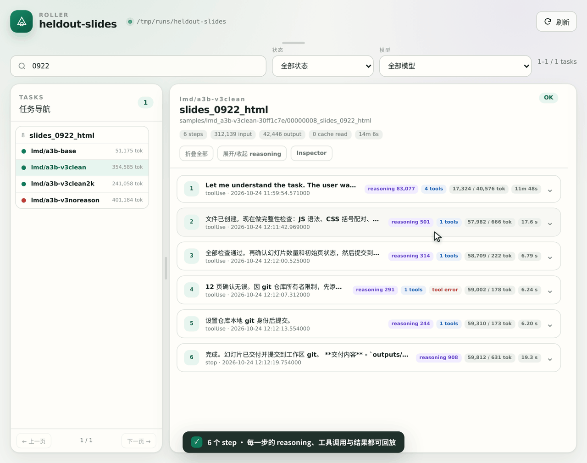
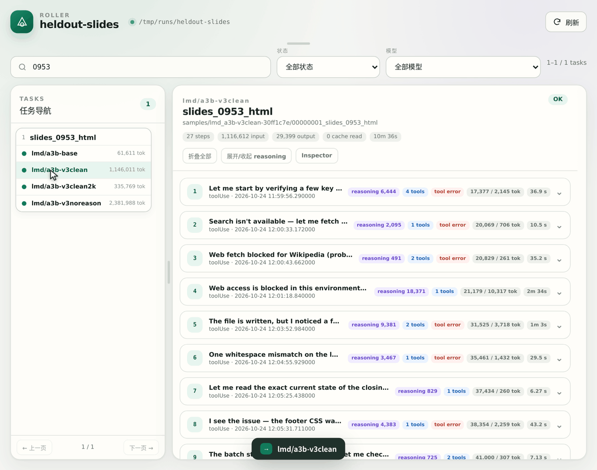
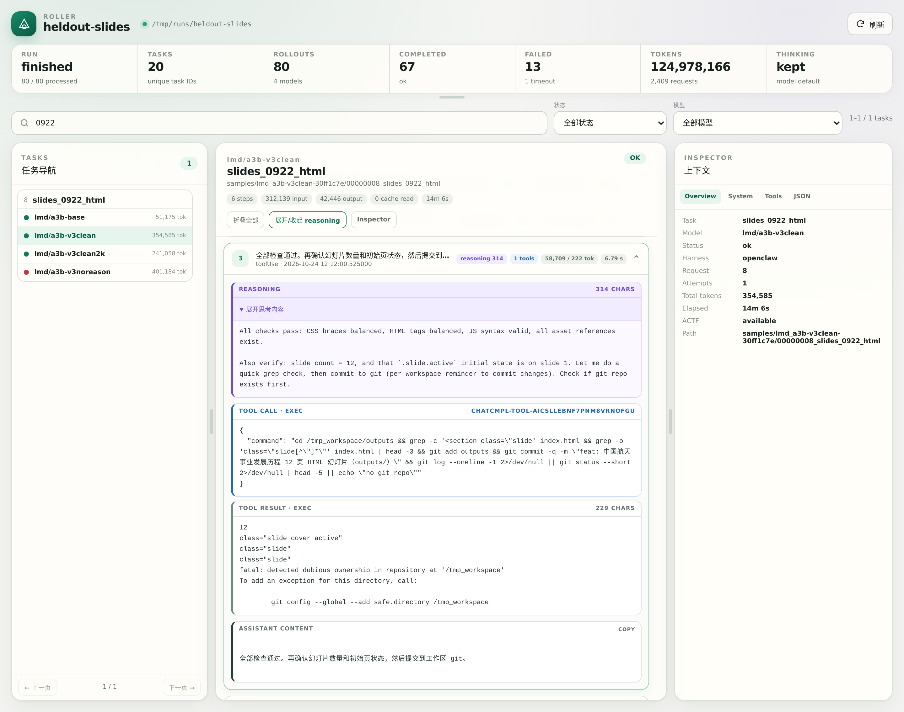
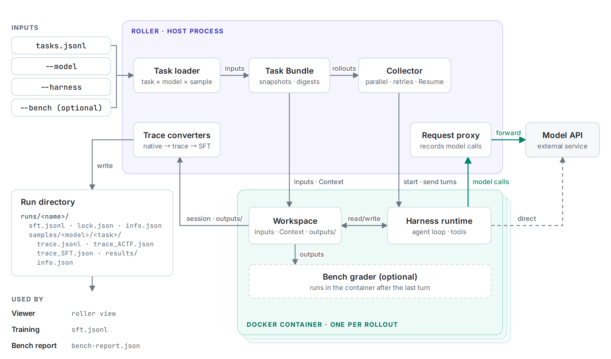
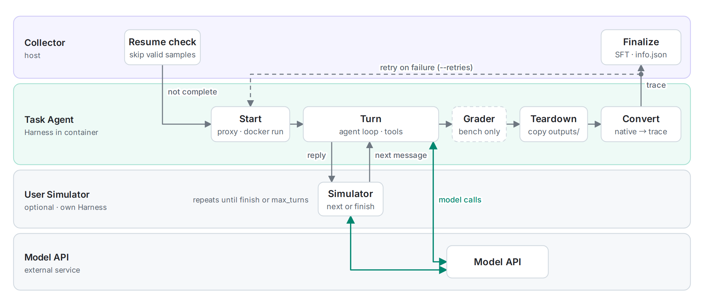
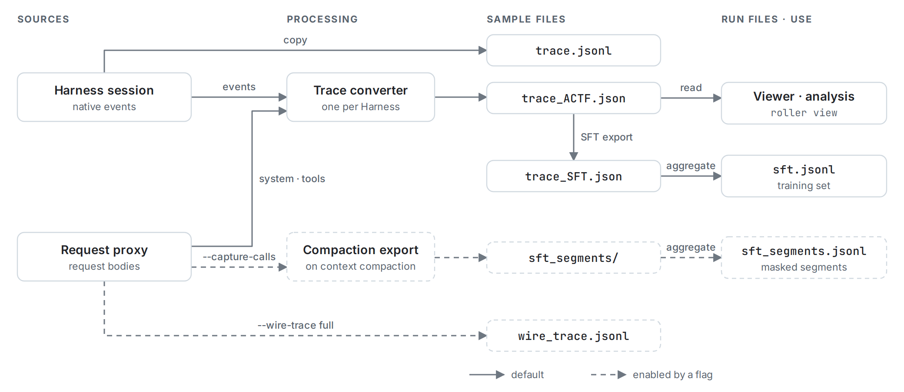

<p align="center">
  <picture>
    <source media="(prefers-color-scheme: dark)" srcset="assets/roller-logo-dark.png">
    
  </picture>
</p>
<h1 align="center">Roller</h1>
<p align="center"><strong>Agent trajectory collection across models and Harnesses</strong></p>
<p align="center">Roller runs tool-using agents in disposable Docker containers and stores, for every task and model combination, the native session, a unified trace, SFT training data and the generated files.</p>

<p align="center">
  <a href="#harnesses"></a>
  <a href="#benchmarks"></a>
  <a href="LICENSE"></a>
  <a href="pyproject.toml"></a>
</p>

<p align="center">
  <strong>English</strong> · <a href="README_zh-CN.md">简体中文</a><br>
  <a href="docs/en/index.md">Documentation</a> · <a href="docs/en/start/getting-started.md">Getting started</a> · <a href="docs/en/start/cli-reference.md">CLI reference</a> · <a href="examples/README.md">Examples</a>
</p>

<p align="center">
  <a href="#news">News</a> · <a href="#architecture">Architecture</a> · <a href="#highlights">Features</a> · <a href="#quick-start">Quick start</a> · <a href="#harnesses">Harnesses</a> · <a href="#outputs">Outputs</a> · <a href="#benchmarks">Benchmarks</a> · <a href="#documentation">Docs</a> · <a href="#contributing">Contributing</a>
</p>

<a id="introduction"></a>

## Introduction

Roller is infrastructure for agent runtimes that provides agent rollout and evaluation services. Users supply tasks and custom environments; Roller runs the agent in an isolated Docker container, collects the complete agent trajectory and evaluates the task result. Roller currently supports seven mainstream Harnesses, including OpenClaw, Codex and Claude Code, and four benchmarks, including WildClawBench and SkillsBench.

A Harness is the agent runtime that executes a task. A task can define its own environment: container image or image build definition, setup commands, environment variables, input files and Context. One execution of one task with one model is a rollout. Roller runs each rollout in its own disposable container and stores the result on the host as a sample. A sample contains the Harness-native session, a normalized trace, an SFT (supervised fine-tuning) record, the files produced by the agent and an `info.json` file with status, usage and provenance.

Roller provides the following capabilities:

- **Benchmark integration.** One command converts benchmark tasks into Roller tasks, collects the trajectories and grades each sample in the container where it ran.
- **Batch collection.** Rollouts run in parallel across tasks and models, with retries for failed attempts and Resume for interrupted runs.
- **SFT data export.** Each successful rollout yields a `messages` + `tools` training record; rollouts with compacted context are exported as separate segment records.
- **Multi-turn conversations and User Simulator.** User turns are predefined in the task or generated by a second model that acts as the user.
- **Viewer.** A built-in read-only web interface for browsing tasks, comparing models and inspecting each step.

<p align="center">
  <a href="assets/demo/viewer-trajectory.gif"></a>
  <a href="assets/demo/viewer-models.gif"></a>
  <a href="assets/demo/viewer.png"></a>
</p>
<p align="center"><sub>Recordings of the built-in Viewer. Left: step-by-step inspection of the reasoning, tool calls and tool results of one rollout. Middle: one task compared across four models. Right: the complete Viewer layout. Select an image to view it at full size.</sub></p>

<a id="news"></a>

## News

- **2026-11-11**: SFT export for compacted context. When the Task Agent compacts its context, each verified context window is exported as a separate SFT record under `sft_segments/`.
- **2026-11-08**: QwenClawBench adapter: 100 tasks in 8 domains, with automated grading, hybrid grading and repeated runs per task.
- **2026-11-05**: One-command evaluation for SkillsBench and PinchBench. SFT records support images.
- **2026-11-01**: Hermes, OpenCode, DeepSeek Harness and Pi Agent added, for a total of seven Harnesses.

<a id="architecture"></a>

## Architecture

Roller runs as a single host process. The Collector schedules rollouts in parallel and starts one Docker container per rollout. Inside the container, the Harness runtime executes the agent loop in a workspace that contains the declared inputs and Context. Depending on the Harness and the `--wire-trace` setting, model requests either pass through Roller's request proxy, which records them before forwarding, or go directly to the model API. After the last turn, Roller collects the native session and the output directory, and the trace converters write the sample to the run directory.

<p align="center">
  <a href="assets/diagrams/architecture-en-light.png"><picture>
    <source media="(prefers-color-scheme: dark)" srcset="assets/diagrams/architecture-en-dark.png">
    
  </picture></a>
</p>
<p align="center"><sub>Green arrows: model calls. Dashed elements: optional components and conditional paths.</sub></p>

Each rollout follows the lifecycle below. The Collector first checks whether a valid sample already exists. Otherwise it starts the container, and the Harness executes the turns. With a User Simulator, each Task Agent reply is passed to the Simulator, which returns the next user message or ends the conversation. For bench runs, the grader runs before teardown. After teardown, Roller converts the native session to the normalized trace; the Collector then either retries a failed attempt (up to `--retries` times) or finalizes the sample.

<p align="center">
  <a href="assets/diagrams/lifecycle-en-light.png"><picture>
    <source media="(prefers-color-scheme: dark)" srcset="assets/diagrams/lifecycle-en-dark.png">
    
  </picture></a>
</p>

<a id="highlights"></a>

## Features

- **Unified Harness interface.** OpenClaw, Codex, Claude Code, Hermes, OpenCode, DeepSeek Harness and Pi Agent read the same task format and are selected with `--harness`. Samples from every Harness use the same directory layout and the same normalized trace structure.
- **Step-level traces.** Each step in the normalized trace records the visible reasoning, tool calls, tool results, token counts and timing. With `--wire-trace full`, Roller also stores every request body that its proxy forwards to the model API.
- **Evaluation in the task container.** `roller collect --bench` exports the benchmark tasks, runs them and executes each grader in the container where the task ran, before teardown. Grading failures are recorded separately from zero scores, and `bench-report.json` aggregates the results.
- **Reproducible batch collection.** Roller snapshots and hashes all inputs before a container starts, and `lock.json` records the settings that determine sample content. `--resume` skips completed samples and reruns the remaining ones; if a recorded setting has changed, it reports the difference and exits. `--retries N` allows up to N additional attempts for each failed rollout.
- **Training data with images and compaction segments.** SFT records include an `images` field when the trace contains images. When the Task Agent compacts its context, each verified context window is exported to `sft_segments/` with a `target_start_index` that marks the supervised messages.
- **Dynamic conversations.** The User Simulator runs in its own Harness, reads the conversation so far and either sends the next user message or ends the task. It can use a different Harness and model from the Task Agent.
- **Local Viewer.** `roller view` reads an existing run directory without modifying it, requires no additional dependencies and listens on `127.0.0.1` by default.

<a id="quick-start"></a>

## Quick start

The following procedure collects a first batch of trajectories with OpenClaw, the default Harness.

### 1. Installation

Requirements: Python 3.10 or later and a running Docker daemon.

```bash
git clone https://github.com/Liuziyu77/Roller.git
cd Roller
conda create -n roller python=3.11 -y
conda activate roller
python -m pip install -e .

docker pull ghcr.io/openclaw/openclaw:2026.7.1-2
```

With Docker Desktop on macOS, enable **Enable host networking** under **Settings → Resources → Network** and restart Docker Desktop. To install the image offline from a `docker save` archive, run `docker load -i <archive>` instead of `docker pull`.

### 2. Model configuration

Copy the environment template, set `MY_PROXY_BASE_URL` and `MY_PROXY_API_KEY`, and export the variables to the current shell. `examples/env/api.env` is excluded by `.gitignore`.

```bash
cp examples/env/api.env.example examples/env/api.env
# Edit examples/env/api.env, then export its variables:
set -a; source examples/env/api.env; set +a
```

In [`examples/config/openclaw/models.json`](examples/config/openclaw/models.json), set the model `id` to the model name used by the service. Commands reference a model as `<provider>/<id>`, where `<provider>` is the key under `providers`. With the example file, the model reference is `my-openai-proxy/my-model`. For services that support only `/chat/completions`, change `api` from `openai-responses` to `openai-completions`. Store API keys only in environment variables; do not include them in tasks, commands or version-controlled files.

### 3. Dry run and collection

```bash
roller collect \
  --tasks examples/tasks/tasks.jsonl \
  --model my-openai-proxy/my-model \
  --model-config examples/config/openclaw/models.json \
  --parallel 4 \
  --dry-run
```

A dry run parses the tasks, validates the input files and prints the planned rollouts. It does not start containers or call the model API, so it does not detect a missing image or an invalid API key. After verifying the plan, remove `--dry-run`, set a run name and enable one retry per failed rollout:

```bash
roller collect \
  --tasks examples/tasks/tasks.jsonl \
  --model my-openai-proxy/my-model \
  --model-config examples/config/openclaw/models.json \
  --parallel 4 --retries 1 --timeout 600 \
  --output runs --run-name quickstart
```

To compare models, repeat `--model`; each task then runs once per model. To continue an interrupted run, rerun the same command with `--resume`. If a setting recorded in `lock.json` has changed, use a new `--run-name`.

### 4. Viewer

```bash
roller view runs/quickstart
```

Open the URL printed in the terminal (default `http://127.0.0.1:17865`). The Viewer shows the messages, reasoning, tool calls, tool results and final reply of each task.

[Getting started guide →](docs/en/start/getting-started.md)

<a id="harnesses"></a>

## Harnesses

A Harness is the agent runtime inside the container. It starts the agent, provides its tools and calls the model API. Specify the Harness for all tasks with `--harness`, or for an individual task with the `harness` field.

| Harness | Model API | Description |
| --- | --- | --- |
| OpenClaw (default) | OpenAI Responses or Chat Completions | Custom and open models; multimodal input |
| Codex | Responses | Codex CLI with GPT or Responses-compatible services |
| Claude Code | Anthropic `/v1/messages` | Claude Code with native thinking |
| Hermes | OpenAI Chat Completions | Hermes Agent with terminal and file tools |
| OpenCode | OpenAI Chat Completions | OpenCode CLI sessions with text and file tools |
| DeepSeek Harness | DeepSeek Chat Completions | Official SDK with a single persistent Bash tool |
| Pi Agent | OpenAI Chat Completions | Pi SDK with seven tools: `read`, `bash`, `edit`, `write`, `grep`, `find`, `ls` |

OpenClaw reads model definitions from `--model-config`. The other six Harnesses use `--api-base` and `--api-key-env`. In runs that combine several Harnesses, each Harness takes its own prefixed pair, for example `--hermes-api-base` and `--hermes-api-key-env`.

Every Harness can serve as the Task Agent or the User Simulator. Docker images, API settings and reasoning options differ per Harness and are described in the Harness guides: [OpenClaw](docs/en/harnesses/openclaw-configuration.md) · [Codex](docs/en/harnesses/codex-configuration.md) · [Claude Code](docs/en/harnesses/claude-code-configuration.md) · [Hermes](docs/en/harnesses/hermes-configuration.md) · [OpenCode](docs/en/harnesses/opencode-configuration.md) · [DeepSeek](docs/en/harnesses/deepseek-configuration.md) · [Pi Agent](docs/en/harnesses/pi-configuration.md).

<a id="outputs"></a>

## Outputs

Each run is stored in one directory. Run-level files are at the top level, and each sample has its own directory under `samples/`:

```text
runs/quickstart/
├── info.json            settings, progress and total usage
├── lock.json            settings compared by --resume
├── sft.jsonl            SFT records of successful, uncompacted samples
└── samples/<model>/<index>_<task>/
    ├── trace.jsonl      Harness-native session
    ├── trace_ACTF.json  unified trace: reasoning, tool calls, results, tokens, timing
    ├── trace_SFT.json   SFT record of this sample
    ├── info.json        status, attempts, usage, versions and input digests
    └── results/         files written to the task's output directory
```

Use `sft.jsonl` for training and `trace_ACTF.json` for analysis. `trace.jsonl` retains the Harness-native events for debugging and re-conversion and is not cleaned for training.

The following figure shows how each file is produced. Dashed paths are enabled by the flag shown on the arrow.

<p align="center">
  <a href="assets/diagrams/pipeline-en-light.png"><picture>
    <source media="(prefers-color-scheme: dark)" srcset="assets/diagrams/pipeline-en-dark.png">
    
  </picture></a>
</p>

The following files are produced only under specific conditions:

- `sft_segments/`: written when the Task Agent compacts its context. The rollout is then excluded from `sft.jsonl`, and each verified context window is exported as a separate record. Segment records are listed in the sample's `info.json` and aggregated in the run-level `sft_segments.jsonl`. `target_start_index` identifies the first supervised assistant message; training loaders must mask all preceding messages.
- `wire_trace.jsonl`: written with `--wire-trace full`. It contains every request body that Roller's proxy forwarded to the model API. Its content can differ from the native session when a Harness compacts, truncates or rewrites context.
- `conversation.json`: written for User Simulator tasks. It contains the dialogue visible to both participants.

The [trajectory output guide](docs/en/traces/trajectory-outputs.md) specifies when each file is written or omitted.

### Reasoning

`--keep-thinking` is enabled by default and stores the visible reasoning returned by the model service. `--thinking` sets the requested reasoning level. The stored content depends on the model family:

| Model family | Stored reasoning |
| --- | --- |
| GPT reasoning models | Visible summary or content returned by the service |
| Claude | Visible thinking or summary returned by the service |
| Open models such as Qwen and GLM | Plain-text reasoning returned by the service |

When a service returns only reasoning token counts or encrypted state, `reasoning_content` is empty. `reasoning_content` contains only reasoning text returned by the service; tool arguments remain in `tool_calls`. The reasoning levels available for each OpenClaw model are listed in [Thinking configuration](docs/en/harnesses/openclaw-configuration.md#6-thinking-configuration).

<a id="tasks"></a>

## Tasks

A task is a JSON object. A minimal task contains a schema version, an ID and a prompt:

```json
{"schema_version":"roller.task/v1","id":"hello","prompt":"Compute 2+3. Reply with the number only."}
```

A task list can be a `.jsonl` file, a JSON array or an object of the form `{"tasks": [...]}`. Optional fields define files, Context, conversation turns and runtime settings:

| Field | Purpose |
| --- | --- |
| `messages` | Predefined user turns for a multi-turn conversation |
| `file_root`, `files.inputs` | Local files copied into the workspace |
| `files.context` | Context files such as `AGENTS.md`, `USER.md`, `MEMORY.md` and skills, which the Harness places where the agent discovers them automatically |
| `files.output_dir` | Output directory of the agent; Roller collects its full contents |
| `runtime` | Environment variables, setup commands and task-level thinking |
| `harness` | Harness for this task (also `agent_harness` or `task_agent.harness`); overridden by `--harness` |
| `user_simulator` | Harness and model that act as the user and generate user turns |

`messages` and `user_simulator` are mutually exclusive. All fields are specified in the [task format reference](docs/en/tasks/task-format.md); dynamic conversations are described in the [User Simulator guide](docs/en/tasks/user-simulator.md).

<a id="benchmarks"></a>

## Benchmarks

Bench adapters convert benchmark tasks into Roller tasks and grade each sample in the container where it ran.

| Bench | Default Harness | Scope |
| --- | --- | --- |
| [WildClawBench](docs/en/benches/wildclawbench.md) | `openclaw` | 60 real-scenario tasks in 6 categories |
| [SkillsBench](docs/en/benches/skillsbench.md) | `opencode` | One built environment per task; with-skill and no-skill runs scored by official verifiers |
| [PinchBench](docs/en/benches/pinchbench.md) | `openclaw` | Automated, LLM-judge, hybrid and multi-session tasks |
| [QwenClawBench](docs/en/benches/qwenclawbench.md) | `openclaw` | 100 tasks in 8 domains, with repeated runs per task |

The following example runs WildClawBench. With the upstream repository checked out and its `.env` loaded, one command converts the tasks, collects trajectories, grades every sample and writes `tasks.jsonl` and `bench-report.json` to the run directory:

```bash
roller collect --bench wildclawbench --bench-root ~/WildClawBench \
  --model <provider>/<model> --model-config <models.json> \
  --harness openclaw --openclaw-image wildclawbench-ubuntu:v1.3 \
  --parallel 4 --output runs --run-name wildclaw
```

Each bench guide lists the settings that must match the upstream configuration and the environment variables required by its graders. Scores are directly comparable only when these settings match upstream. To add a bench, see [Bench integration and scoring](docs/en/benches/bench-format.md#6-adding-a-new-bench).

<a id="documentation"></a>

## Documentation

New users should start with [Getting started](docs/en/start/getting-started.md) and refer to [Task format](docs/en/tasks/task-format.md) when writing tasks. The complete handbook is in [`docs/en`](docs/en/index.md). To build it as a website, run `python -m pip install -r docs/requirements-docs.txt` followed by `cd docs && make html`.

| Guide | Contents |
| --- | --- |
| [Introduction](docs/en/start/introduction.md) | Core concepts: task, Harness, rollout, run and trace |
| [Getting started](docs/en/start/getting-started.md) | Installation, dry run, first collection and result verification |
| [CLI reference](docs/en/start/cli-reference.md) | All flags, their defaults and the Harnesses they apply to |
| [Docker builds and package mirrors](docs/en/start/docker-builds.md) | apt, npm and Python mirrors and proxies for image builds |
| [Task format](docs/en/tasks/task-format.md) | Prompts, multi-turn messages, inputs, Context and output directories |
| [Files, Task Bundles and result storage](docs/en/tasks/task-bundle-and-storage.md) | Input snapshots, run layout, retries and Resume |
| [User Simulator](docs/en/tasks/user-simulator.md) | Dynamic conversations driven by a second model |
| [Trajectory outputs](docs/en/traces/trajectory-outputs.md) | Output files and their conditions; comparison of raw, normalized, SFT and wire traces |
| [SFT format](docs/en/traces/sft-format.md) | Record structure, images and compaction segments |
| [Viewer](docs/en/traces/viewer.md) | Startup, ports and remote access |
| [Bench integration and scoring](docs/en/benches/bench-format.md) | Bench runs, grading and new bench adapters |
| [Examples](examples/README.md) (Chinese) | Runnable commands for each Harness |
| [Coverage suite](examples/coverage/README.en.md) | 1,624 functional test tasks across all seven Harnesses |

<a id="security"></a>

## Security and privacy

- Before a container starts, Roller rejects inputs and Context that contain symlinks or special files, escape their declared paths or exceed the size limits, and records a digest of every file.
- API keys are read from the host environment or from external configuration and are not written to run metadata.
- Only regular files and directories inside the task's `output_dir` are collected.
- `wire_trace.jsonl` stores full request text, including prompts, reasoning and tool results. Treat it as sensitive data.
- The Viewer listens on `127.0.0.1` by default. Use SSH port forwarding for remote access.

The complete rules are specified in [Security and privacy boundaries](docs/en/tasks/task-bundle-and-storage.md#8-security-and-privacy-boundaries).

<a id="contributing"></a>

## Contributing

Report defects through [Issues](https://github.com/Liuziyu77/Roller/issues). New Harnesses, new benches and documentation improvements are accepted as [Pull Requests](https://github.com/Liuziyu77/Roller/pulls). The code is organized as follows:

| Area | Location |
| --- | --- |
| Harness adapters | `src/roller/harnesses/`, with trace converters in `src/roller/*_actf.py` |
| Bench adapters | `src/roller/benches/` |
| SFT export | `src/roller/sft.py`, `src/roller/compaction_sft.py` |
| Viewer | `src/roller/viewer/` |

Run the test suite before submitting a pull request:

```bash
PYTHONPATH=src python3 -m unittest discover -s tests -v
```

### Contributors

<table>
  <tr>
    <td align="center">
      <a href="https://github.com/Liuziyu77"><br><sub><b>Liuziyu77</b></sub></a>
    </td>
    <td align="center">
      <a href="https://github.com/yph22"><br><sub><b>yph22</b></sub></a>
    </td>
    <td align="center">
      <a href="https://github.com/SYuan03"><br><sub><b>SYuan03</b></sub></a>
    </td>
    <td align="center">
      <a href="https://github.com/Dodojordi"><br><sub><b>Dodojordi</b></sub></a>
    </td>
    <td align="center">
      <a href="https://github.com/Nina-Hyn"><br><sub><b>Nina-Hyn</b></sub></a>
    </td>
    <td align="center">
      <a href="https://github.com/Credica"><br><sub><b>Credica</b></sub></a>
    </td>
    <td align="center">
      <a href="https://github.com/Orion-DH"><br><sub><b>Orion-DH</b></sub></a>
    </td>
    <td align="center">
      <a href="https://github.com/MqLeet"><br><sub><b>MqLeet</b></sub></a>
    </td>
    <td align="center">
      <a href="https://github.com/yuhangzang"><br><sub><b>yuhangzang</b></sub></a>
    </td>
  </tr>
</table>

<a id="license-and-acknowledgements"></a>

## License and acknowledgements

Roller is licensed under the [Apache License 2.0](LICENSE).

Roller invokes the following third-party agent runtimes and benchmarks: OpenClaw, Codex, Claude Code, Hermes Agent, OpenCode, DeepSeek Harness, Pi Agent, WildClawBench, SkillsBench, PinchBench and QwenClawBench. Their images, code and data are subject to their respective licenses. We thank the authors of these projects.
