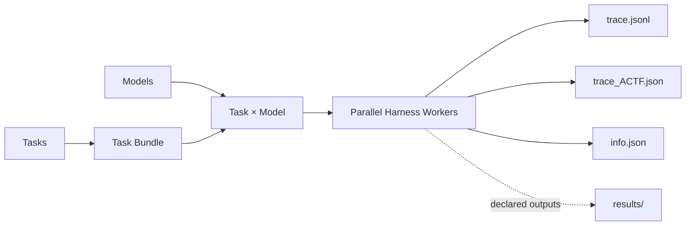

<div align="center">

<h1>Roller</h1>

<p><strong>面向多模型、多 Harness 的 Agentic 轨迹批量采集框架</strong></p>

<p>
  
  
  
  <a href="LICENSE"></a>
</p>

<p>
  <a href="#-快速开始">快速开始</a> ·
  <a href="#-task-格式">Task 格式</a> ·
  <a href="#-输出格式">输出格式</a> ·
  <a href="#-文档">文档</a>
</p>

</div>

Roller 接收一份 task 清单，将 task 与模型展开成执行矩阵，并行运行 Agent Harness，最后把每条 rollout 统一保存为原始轨迹、ACTF 轨迹和精简元信息。

> [!NOTE]
> 当前首个支持的 Harness 是 **OpenClaw**。任务协议、Harness adapter 和结果存储相互独立，后续接入其他 Harness 时无需改变数据集的输入输出约定。



## ✨ 核心能力

- **批量执行**：展开 task × model 矩阵，支持并行、重试和断点续跑
- **多轮任务**：同时支持单轮 `prompt` 和显式多轮 `messages`
- **文件与上下文**：挂载本地文件，并注入 `USER.md`、`MEMORY.md`、`SYSTEM.md`、skills 等上下文
- **输出契约**：允许 task 自定义 Agent 输出目录，只保留用户声明的结果
- **自定义 API**：支持 OpenClaw provider、API base URL 和运行时 API key
- **双格式轨迹**：同时保存 OpenClaw 原始 JSONL 与 `ACTF_v1.0` 标准化轨迹
- **一致性校验**：通过输入和系统文件 digest，保证不同模型使用一致的任务材料

## 🚀 快速开始

### 1. 安装

> [!TIP]
> 运行环境需要 Python 3.10+、Docker，以及一个同时包含 `openclaw` 和 `python3` 的 Docker 镜像。

在 Roller 项目目录中执行：

```bash
python3 -m pip install -e .
```

可以通过命令行传入镜像，也可以设置默认值：

```bash
export ROLLER_OPENCLAW_IMAGE=your-openclaw-image:tag
```

### 2. 检查任务

仓库自带四个轻量示例，分别覆盖纯文本、本地 Markdown、`USER.md`/`MEMORY.md` 和多轮输入：

```bash
roller collect \
  --tasks examples/tasks.jsonl \
  --model my-provider/my-model \
  --parallel 4 \
  --dry-run
```

`--dry-run` 会解析 task、检查依赖文件并打印执行矩阵，但不会启动 Docker。

### 3. 开始采集

```bash
roller collect \
  --tasks examples/tasks.jsonl \
  --model my-provider/my-model \
  --docker-image your-openclaw-image:tag \
  --parallel 4 \
  --timeout 600 \
  --output runs \
  --run-name quickstart
```

结果写入 `runs/quickstart/`。已有成功结果需要复用时，使用相同的输出路径并增加 `--resume`。

## 🧩 Task 格式

任务清单支持 `.json` 和 `.jsonl`。最小单轮 task：

```json
{"schema_version":"roller.task/v1","id":"hello","prompt":"计算 2+3，只回复数字。"}
```

<details>
<summary><strong>查看包含输入文件、系统文件和输出契约的完整 task</strong></summary>

```json
{
  "schema_version": "roller.task/v1",
  "id": "research_001",
  "prompt": "读取 inputs/brief.md，将报告写入 deliverables/report.md。",
  "files": {
    "output_dir": "deliverables",
    "inputs": [
      {"source": "./brief.md", "target": "brief.md"}
    ],
    "context": [
      {"role": "system", "source": "./SYSTEM.md", "capture": "full"}
    ],
    "outputs": [
      {"path": "report.md", "type": "file", "required": true}
    ]
  }
}
```

</details>

最重要的路径约定：

| 配置 | 作用 |
| --- | --- |
| `--output` + `--run-name` | 指定 Roller 在宿主机上的 run 保存位置 |
| `files.inputs[].target` | Agent 通过 `inputs/<target>` 读取的只读输入 |
| `files.output_dir` | Agent 工作区中的可写输出目录，默认 `outputs` |
| `files.outputs[].path` | 相对于 `output_dir`，声明需要校验并保留的结果 |

> [!IMPORTANT]
> 只有 task 声明了 `files.outputs`，对应 sample 才会创建 `results/`。未声明的临时文件不会进入最终数据集。

### 多轮输入

多轮边界直接由 `messages` 数组表达：

```json
{
  "schema_version": "roller.task/v1",
  "id": "multi_turn_001",
  "messages": [
    {"role": "user", "content": "请记住校验词 ROLLER。"},
    {"role": "user", "content": "刚才的校验词是什么？只回复校验词。"}
  ]
}
```

每条 message 会在同一个 OpenClaw session 中依次发送。Roller 不解析正文中的标题、分隔符或其他 Markdown 来猜测轮次。

完整字段定义见 [Task JSON Schema](schemas/task.schema.json)，四类可运行任务见 [examples/tasks.jsonl](examples/tasks.jsonl)。

## 🔌 自定义模型 API

OpenClaw model config 通过 `--model-config` 传入。配置文件支持 `${ENV_NAME}`，API key 无需写入配置或 Roller 仓库：

```bash
export MY_PROXY_BASE_URL=https://api.example.com/v1
export MY_PROXY_API_KEY=your-api-key

roller collect \
  --tasks examples/tasks.jsonl \
  --model my-openai-proxy/my-model \
  --model-config examples/openclaw-models.json \
  --docker-image your-openclaw-image:tag \
  --parallel 4 \
  --output runs \
  --run-name custom_api
```

> [!NOTE]
> 环境变量只在运行时展开。Roller 不把 API key 或环境变量值写入 run；元信息仅记录环境变量名称和脱敏后的 API base URL。

配置示例和路径说明见 [examples/README.md](examples/README.md)。

## 📦 输出格式

每次采集只保留一个 run 级索引和每条 rollout 的核心数据：

```text
<output>/<run-name>/
├── info.json
└── samples/<model>/<index>_<task>/
    ├── trace.jsonl          # OpenClaw 原始 session 轨迹，不做清洗
    ├── trace_ACTF.json      # ACTF_v1.0 trajectory object
    ├── info.json            # 状态、usage、attempt、版本和 digest
    └── results/             # 可选；仅保存 task 声明的输出
```

- `trace.jsonl` 用于保留 Harness 的原始事实来源。
- `trace_ACTF.json` 将 assistant、tool call、observation 和多轮 user message 组织成统一 step。
- `info.json` 保存状态、错误、token/cost usage、运行耗时、版本及输入来源 digest。
- `results/` 只在用户明确声明输出契约时存在。

运行期 Task Bundle、容器日志、retry 中间文件和未声明输出不会散落在最终 run 中。

## ⚙️ 常用执行选项

| 选项 | 说明 |
| --- | --- |
| `--model` | 指定模型；可重复使用，对每个模型运行全部 task |
| `--parallel N` | 同时运行的 trajectory 数量 |
| `--retries N` | 失败后的重试次数 |
| `--resume` | 跳过 Task Bundle digest 未变化的成功 sample |
| `--start-index N` / `--limit N` | 只运行 task 清单的一个区间 |
| `--timeout N` | 每条 trajectory 的总超时时间，单位秒 |
| `--pass-env NAME` | 额外向 OpenClaw 容器传递一个环境变量 |

查看全部选项：

```bash
roller collect --help
```

## 📚 文档

| 文档 | 内容 |
| --- | --- |
| [Examples](examples/README.md) | 四类示例任务、自定义 API 和路径对应关系 |
| [Task 文件与存储设计](docs/task-bundle-and-storage.md) | 输入快照、系统文件注入、输出校验、ACTF 和 resume 细节 |
| [Task JSON Schema](schemas/task.schema.json) | `roller.task/v1` 的机器可读字段约束 |

## 🧪 开发与测试

当前 Harness 接口位于 [src/roller/harnesses/base.py](src/roller/harnesses/base.py)，OpenClaw adapter 位于 [src/roller/harnesses/openclaw.py](src/roller/harnesses/openclaw.py)。新增 Harness 时可以复用现有 task、bundle、collector 和存储协议，并实现对应的标准轨迹转换。

运行测试：

```bash
PYTHONPATH=src python3 -m unittest discover -s tests -v
```

## 📄 License

[Apache License 2.0](LICENSE)
