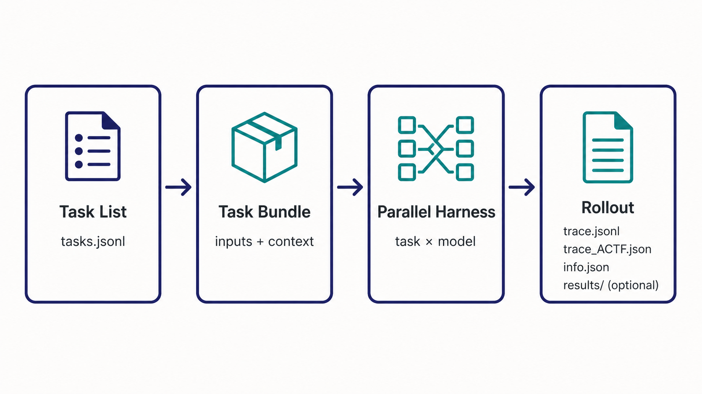

<div align="center">
  
  <h1>Roller</h1>
  <p><strong>批量采集可复现的 Agentic 轨迹</strong></p>
  <p>
    
    
    
    <a href="LICENSE"></a>
  </p>
</div>

Roller 读取 task 清单，按 task × model 展开任务，并行运行 Harness，再把每次 rollout 保存成统一、精简的目录。目前支持 OpenClaw。

<p align="center">
  
</p>

## 核心能力

- 一份 task 清单可以跑一个或多个模型，支持并行、重试和断点续跑。
- task 可以带本地文件，也可以注入 `USER.md`、`MEMORY.md`、`SYSTEM.md` 和 skills。
- 单轮使用 `prompt`；多轮直接写多个 `messages`，不解析正文里的分隔符。
- 每个 task 可以指定自己的输出目录，并声明哪些结果需要保留。
- 同时保存 OpenClaw 原始轨迹和 `ACTF_v1.0`，方便回放、训练或评测。
- 自定义 provider、API base URL 和 API key 都通过 OpenClaw 配置与环境变量传入。

## 快速开始

需要 Python 3.10+、Docker，以及一个包含 `openclaw` 和 `python3` 的镜像。

```bash
python3 -m pip install -e .
```

先检查四个示例 task，不启动 Docker：

```bash
roller collect \
  --tasks examples/tasks/tasks.jsonl \
  --model my-provider/my-model \
  --parallel 4 \
  --dry-run
```

开始采集：

```bash
roller collect \
  --tasks examples/tasks/tasks.jsonl \
  --model my-provider/my-model \
  --docker-image your-openclaw-image:tag \
  --parallel 4 \
  --output runs \
  --run-name quickstart
```

结果写入 `runs/quickstart/`。需要复用已有成功结果时，加上 `--resume`。

## Task 格式

任务清单支持 JSON 和 JSONL：

```json
{
  "schema_version": "roller.task/v1",
  "id": "research_001",
  "prompt": "读取 inputs/brief.md，将报告写入 deliverables/report.md。",
  "files": {
    "output_dir": "deliverables",
    "inputs": [
      {"source": "./brief.md", "target": "brief.md"}
    ],
    "context": [
      {"role": "system", "source": "./SYSTEM.md"}
    ],
    "outputs": [
      {"path": "report.md", "required": true}
    ]
  }
}
```

| 配置 | 含义 |
| --- | --- |
| `--output` + `--run-name` | Roller 在宿主机上的保存位置 |
| `files.inputs[].target` | Agent 通过 `inputs/<target>` 读取的文件 |
| `files.output_dir` | Agent 写文件的位置，默认 `outputs` |
| `files.outputs[].path` | 需要复制到 `results/` 的文件 |

多轮 task、文件输入和 context 示例见 [examples/tasks/tasks.jsonl](examples/tasks/tasks.jsonl)，完整字段见 [Task JSON Schema](schemas/task.schema.json)。

## 模型与环境变量

示例按用途分开存放：

| 文件 | 用途 |
| --- | --- |
| [openclaw-models.json](examples/json/openclaw-models.json) | 普通文本模型配置 |
| [openclaw-models-multimodal.json](examples/json/openclaw-models-multimodal.json) | 支持 `input: ["text", "image"]` 的多模态模型配置 |
| [api.env.example](examples/env/api.env.example) | API base、API key 和 `BRAVE_API_KEY` 模板 |

配置中的 `${ENV_NAME}` 只在运行时展开，真实 key 不会写入 run。完整运行命令见 [Examples](examples/README.md)。

## 输出格式

```text
<output>/<run-name>/
├── info.json
└── samples/<model>/<index>_<task>/
    ├── trace.jsonl          # OpenClaw 原始轨迹
    ├── trace_ACTF.json      # ACTF_v1.0
    ├── info.json            # 状态、usage、耗时和版本
    └── results/             # 可选；只保存声明的输出
```

没有声明 `files.outputs` 的 task 不会创建 `results/`。输入快照、context 注入、ACTF 映射和 resume 规则见 [Task 文件与存储设计](docs/task-bundle-and-storage.md)。

## 开发与测试

Harness 接口位于 [src/roller/harnesses/base.py](src/roller/harnesses/base.py)，OpenClaw adapter 位于 [src/roller/harnesses/openclaw.py](src/roller/harnesses/openclaw.py)。

```bash
PYTHONPATH=src python3 -m unittest discover -s tests -v
```

## License

[Apache License 2.0](LICENSE)
