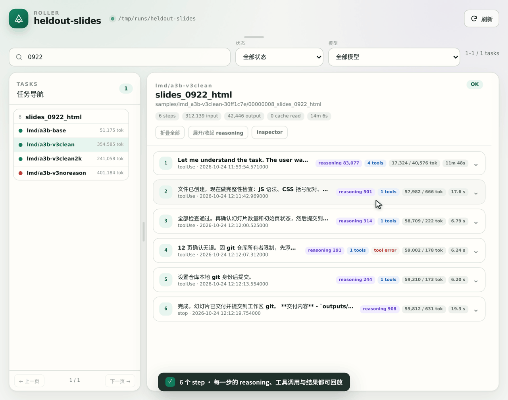
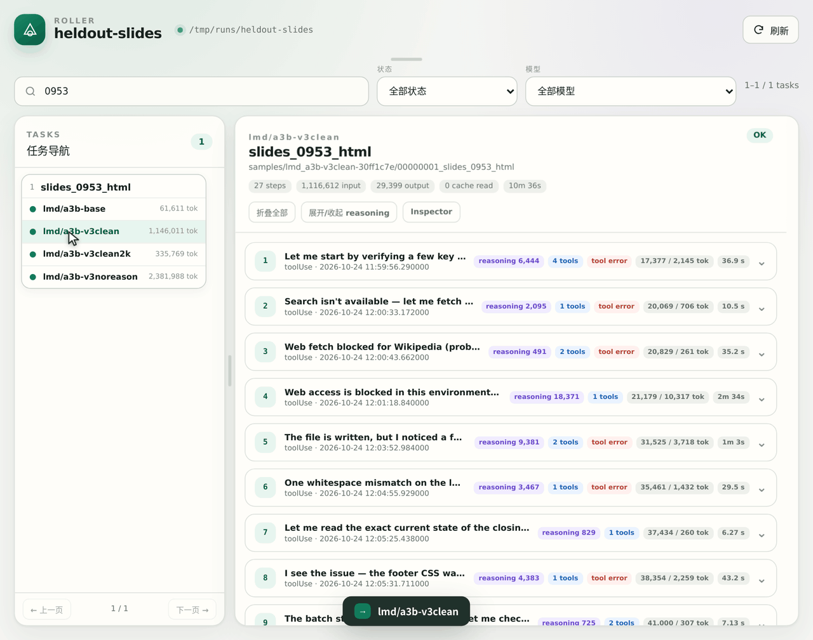
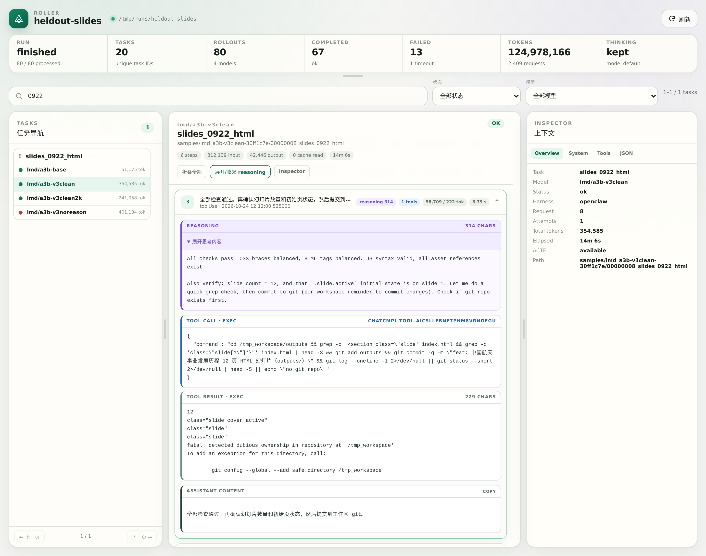
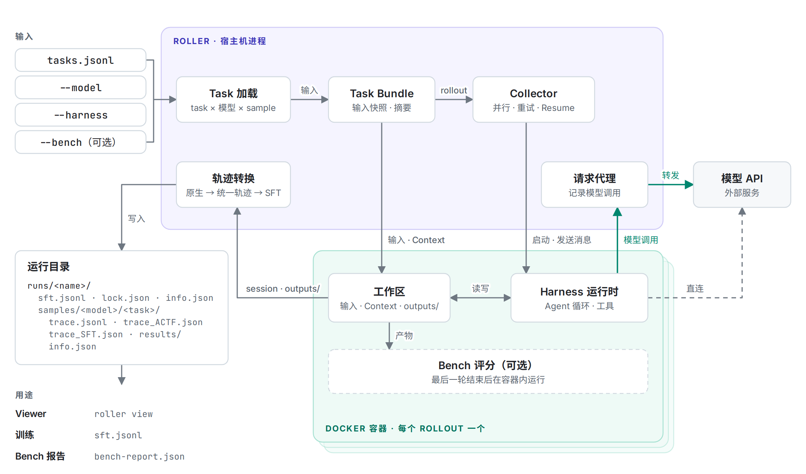
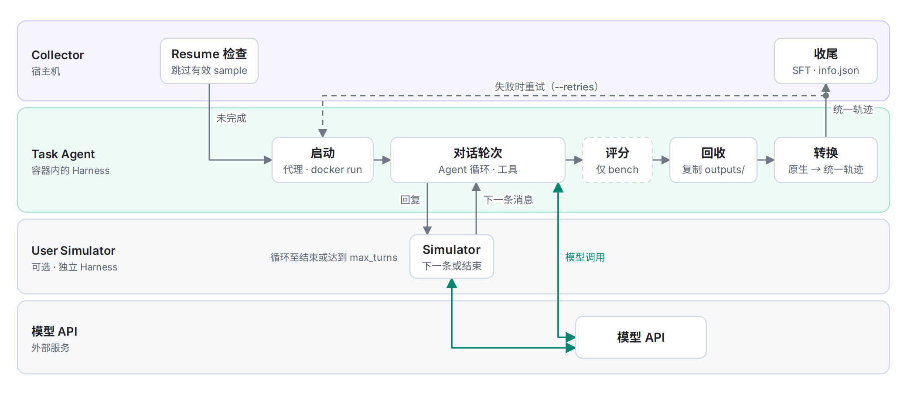
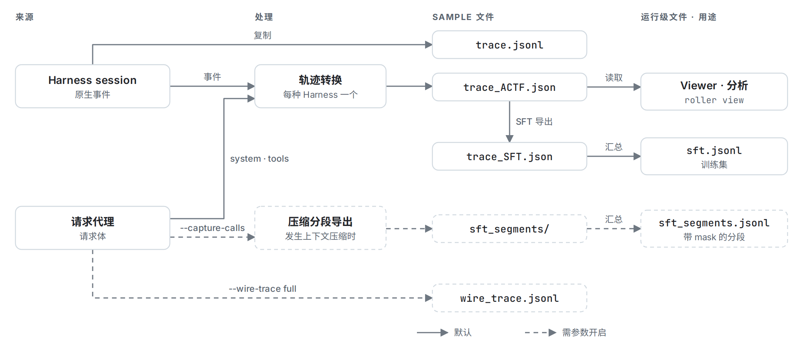

<p align="center">
  <picture>
    <source media="(prefers-color-scheme: dark)" srcset="assets/roller-logo-dark.png">
    
  </picture>
</p>
<h1 align="center">Roller</h1>
<p align="center"><strong>面向多模型、多 Harness 的 Agent 轨迹采集框架</strong></p>
<p align="center">Roller 在一次性 Docker 容器中运行可调用工具的 Agent，并为每个 task 与模型的组合保存原生 session、统一轨迹、SFT 训练数据和产物文件。</p>

<p align="center">
  <a href="#harnesses"></a>
  <a href="#benchmarks"></a>
  <a href="LICENSE"></a>
  <a href="pyproject.toml"></a>
</p>

<p align="center">
  <a href="README.md">English</a> · <strong>简体中文</strong><br>
  <a href="docs/zh/index.md">文档</a> · <a href="docs/zh/start/getting-started.md">快速上手</a> · <a href="docs/zh/start/cli-reference.md">CLI 参数</a> · <a href="examples/README.md">示例</a>
</p>

<p align="center">
  <a href="#news">最新动态</a> · <a href="#architecture">架构</a> · <a href="#highlights">主要特性</a> · <a href="#quick-start">快速开始</a> · <a href="#harnesses">Harness</a> · <a href="#outputs">产物</a> · <a href="#benchmarks">Benchmark</a> · <a href="#documentation">文档</a> · <a href="#contributing">参与贡献</a>
</p>

<a id="introduction"></a>

## 简介

Roller 是一套服务于 Agent Runtime 的基础设施，提供 Agent 推理与评测服务。用户提供任务与自定义环境，Roller 在隔离的 Docker 容器中运行 Agent，采集完整的 Agent 轨迹，并对任务结果进行评测。目前 Roller 支持 OpenClaw、Codex、Claude Code 等 7 种主流 Harness，以及 WildClawBench、SkillsBench 等 4 个 Benchmark。

Harness 是执行 task 的 Agent 运行时。task 可自定义运行环境，包括容器镜像或镜像构建定义、setup 命令、环境变量、输入文件和 Context。一个 task 与一个模型的单次执行称为 rollout。Roller 为每个 rollout 启动独立的一次性容器，并将结果以 sample 的形式保存到宿主机。sample 包含 Harness 原生 session、统一结构的轨迹、SFT（监督微调）记录、Agent 生成的文件，以及记录状态、用量和来源信息的 `info.json`。

Roller 提供以下能力：

- **Benchmark 集成。** 一条命令完成 Benchmark 任务转换、轨迹采集，并在各 sample 的运行容器内完成评分。
- **批量采集。** 跨 task 与模型并行执行 rollout，失败的尝试可自动重试，中断的运行可通过 Resume 继续。
- **SFT 数据导出。** 每个成功的 rollout 生成一条 `messages` + `tools` 训练记录；发生上下文压缩的 rollout 以分段记录的形式单独导出。
- **多轮对话与 User Simulator。** 用户消息可在 task 中预先定义，也可由扮演用户的另一个模型生成。
- **Viewer。** 内置只读 Web 界面，用于浏览 task、对比模型和查看每个 step。

<p align="center">
  <a href="assets/demo/viewer-trajectory.gif"></a>
  <a href="assets/demo/viewer-models.gif"></a>
  <a href="assets/demo/viewer.png"></a>
</p>
<p align="center"><sub>以上内容录制自内置 Viewer。左：逐步查看单个 rollout 的 reasoning、工具调用和工具结果；中：同一 task 在 4 个模型间的对比；右：Viewer 完整界面。点击图片可查看原图。</sub></p>

<a id="news"></a>

## 最新动态

- **2026-11-11**：支持上下文压缩场景下的 SFT 导出。Task Agent 压缩上下文时，每段通过校验的上下文窗口作为独立的 SFT 记录导出至 `sft_segments/`。
- **2026-11-08**：新增 QwenClawBench 适配，覆盖 8 个领域的 100 个任务，支持自动评分、混合评分和单题多次运行。
- **2026-11-05**：新增 SkillsBench 与 PinchBench 一键评测；SFT 记录支持图片。
- **2026-11-01**：新增 Hermes、OpenCode、DeepSeek Harness 和 Pi Agent，支持的 Harness 增至 7 种。

<a id="architecture"></a>

## 架构

Roller 以单个宿主机进程运行。Collector 并行调度 rollout，并为每个 rollout 启动一个 Docker 容器。容器内，Harness 运行时在包含声明输入和 Context 的工作区中执行 Agent 循环。根据 Harness 类型和 `--wire-trace` 设置，模型请求或经由 Roller 的请求代理记录后转发，或直接发送至模型 API。最后一轮结束后，Roller 回收原生 session 和输出目录，由轨迹转换器将 sample 写入运行目录。

<p align="center">
  <a href="assets/diagrams/architecture-zh-light.png"><picture>
    <source media="(prefers-color-scheme: dark)" srcset="assets/diagrams/architecture-zh-dark.png">
    
  </picture></a>
</p>
<p align="center"><sub>绿色箭头表示模型调用；虚线表示可选组件和条件路径。</sub></p>

每个 rollout 的生命周期如下。Collector 首先检查是否已存在有效的 sample；若不存在，则启动容器，由 Harness 执行各轮对话。使用 User Simulator 时，Task Agent 的每次回复交由 Simulator 处理，Simulator 返回下一条用户消息或结束对话。bench 运行时，评分程序在回收之前执行。回收完成后，Roller 将原生 session 转换为统一结构的轨迹；随后 Collector 对失败的尝试进行重试（最多 `--retries` 次），或完成 sample 收尾。

<p align="center">
  <a href="assets/diagrams/lifecycle-zh-light.png"><picture>
    <source media="(prefers-color-scheme: dark)" srcset="assets/diagrams/lifecycle-zh-dark.png">
    
  </picture></a>
</p>

<a id="highlights"></a>

## 主要特性

- **统一的 Harness 接口。** OpenClaw、Codex、Claude Code、Hermes、OpenCode、DeepSeek Harness 和 Pi Agent 使用相同的 task 格式，通过 `--harness` 选择。各 Harness 产生的 sample 采用相同的目录结构和统一的轨迹结构。
- **逐步轨迹记录。** 统一结构轨迹的每个 step 记录可见 reasoning、工具调用、工具结果、token 数和耗时。启用 `--wire-trace full` 后，Roller 还会保存其代理转发给模型 API 的全部请求体。
- **在任务容器内评测。** `roller collect --bench` 导出 Benchmark 任务并执行，在容器回收前于同一容器内运行评分程序。评分失败与零分分开记录，结果汇总至 `bench-report.json`。
- **可复现的批量采集。** 容器启动前，Roller 为全部输入生成快照并计算摘要，`lock.json` 记录决定 sample 内容的配置。`--resume` 跳过已完成的 sample 并重新执行其余部分；若记录的配置发生变化，则报告差异并退出。`--retries N` 为每个失败的 rollout 提供最多 N 次额外尝试。
- **支持图片与压缩分段的训练数据。** 轨迹包含图片时，SFT 记录附带 `images` 字段。Task Agent 压缩上下文时，每段通过校验的上下文窗口导出至 `sft_segments/`，并通过 `target_start_index` 标识参与训练的消息。
- **动态对话。** User Simulator 运行在独立的 Harness 中，读取当前对话后发送下一条用户消息或结束任务，可使用与 Task Agent 不同的 Harness 和模型。
- **本地 Viewer。** `roller view` 直接读取已有运行目录且不做修改，无需额外依赖，默认仅监听 `127.0.0.1`。

<a id="quick-start"></a>

## 快速开始

以下步骤使用默认 Harness OpenClaw 完成首次轨迹采集。

### 1. 安装

环境要求：Python 3.10 及以上版本，以及正在运行的 Docker daemon。

```bash
git clone https://github.com/Liuziyu77/Roller.git
cd Roller
conda create -n roller python=3.11 -y
conda activate roller
python -m pip install -e .

docker pull ghcr.io/openclaw/openclaw:2026.7.1-2
```

在 macOS 上使用 Docker Desktop 时，需在 **Settings → Resources → Network** 中启用 **Enable host networking** 并重启 Docker Desktop。如需从 `docker save` 归档离线安装镜像，请使用 `docker load -i <归档文件>` 代替 `docker pull`。

### 2. 配置模型

复制环境变量模板，设置 `MY_PROXY_BASE_URL` 和 `MY_PROXY_API_KEY`，并将变量导出到当前 shell。`examples/env/api.env` 已在 `.gitignore` 中排除。

```bash
cp examples/env/api.env.example examples/env/api.env
# 编辑 examples/env/api.env，然后导出其中的变量：
set -a; source examples/env/api.env; set +a
```

在 [`examples/config/openclaw/models.json`](examples/config/openclaw/models.json) 中，将模型 `id` 设置为服务端使用的模型名称。命令中以 `<provider>/<id>` 引用模型，其中 `<provider>` 为 `providers` 下的键名。使用示例文件时，模型引用为 `my-openai-proxy/my-model`。若服务仅支持 `/chat/completions`，需将 `api` 由 `openai-responses` 改为 `openai-completions`。API Key 仅应保存在环境变量中，不应写入 task、命令或受版本控制的文件。

### 3. 预检与采集

```bash
roller collect \
  --tasks examples/tasks/tasks.jsonl \
  --model my-openai-proxy/my-model \
  --model-config examples/config/openclaw/models.json \
  --parallel 4 \
  --dry-run
```

Dry-run 解析 task、校验输入文件并输出计划创建的 rollout。该过程不启动容器，也不调用模型 API，因此无法发现镜像缺失或 API Key 无效等问题。确认计划无误后，移除 `--dry-run`，设置运行名称，并为每个失败的 rollout 启用一次重试：

```bash
roller collect \
  --tasks examples/tasks/tasks.jsonl \
  --model my-openai-proxy/my-model \
  --model-config examples/config/openclaw/models.json \
  --parallel 4 --retries 1 --timeout 600 \
  --output runs --run-name quickstart
```

如需对比多个模型，可重复指定 `--model`，每个 task 将对每个模型各执行一次。运行中断后，在原命令中添加 `--resume` 即可继续。若 `lock.json` 中记录的配置发生变化，应使用新的 `--run-name`。

### 4. 查看结果

```bash
roller view runs/quickstart
```

打开终端输出的地址（默认 `http://127.0.0.1:17865`）。Viewer 展示每个 task 的消息、reasoning、工具调用、工具结果和最终回复。

[快速上手指南 →](docs/zh/start/getting-started.md)

<a id="harnesses"></a>

## Harness

Harness 是容器内的 Agent 运行时，负责启动 Agent、提供工具并调用模型 API。可通过 `--harness` 为全部 task 指定 Harness，或在 task 中通过 `harness` 字段单独指定。

| Harness | 模型 API | 说明 |
| --- | --- | --- |
| OpenClaw（默认） | OpenAI Responses 或 Chat Completions | 自定义模型与开源模型；支持多模态输入 |
| Codex | Responses | Codex CLI；适用于 GPT 及兼容 Responses 的服务 |
| Claude Code | Anthropic `/v1/messages` | Claude Code；支持原生 thinking |
| Hermes | OpenAI Chat Completions | Hermes Agent；提供终端与文件工具 |
| OpenCode | OpenAI Chat Completions | OpenCode CLI session；提供文本与文件工具 |
| DeepSeek Harness | DeepSeek Chat Completions | 官方 SDK；提供单个持久化 Bash 工具 |
| Pi Agent | OpenAI Chat Completions | Pi SDK；提供 7 个工具：`read`、`bash`、`edit`、`write`、`grep`、`find`、`ls` |

OpenClaw 通过 `--model-config` 读取模型定义，其余六种 Harness 使用 `--api-base` 与 `--api-key-env`。同一次运行组合多种 Harness 时，各 Harness 使用带前缀的参数，例如 `--hermes-api-base` 与 `--hermes-api-key-env`。

所有 Harness 均可作为 Task Agent 或 User Simulator。各 Harness 的 Docker 镜像、API 配置和 reasoning 参数不同，详见对应指南：[OpenClaw](docs/zh/harnesses/openclaw-configuration.md) · [Codex](docs/zh/harnesses/codex-configuration.md) · [Claude Code](docs/zh/harnesses/claude-code-configuration.md) · [Hermes](docs/zh/harnesses/hermes-configuration.md) · [OpenCode](docs/zh/harnesses/opencode-configuration.md) · [DeepSeek](docs/zh/harnesses/deepseek-configuration.md) · [Pi Agent](docs/zh/harnesses/pi-configuration.md)。

<a id="outputs"></a>

## 产物

每次运行保存在一个目录中。运行级文件位于顶层，每个 sample 在 `samples/` 下有独立目录：

```text
runs/quickstart/
├── info.json            配置、进度和总用量
├── lock.json            --resume 比对的配置
├── sft.jsonl            成功且未压缩的 sample 的 SFT 记录
└── samples/<model>/<index>_<task>/
    ├── trace.jsonl      Harness 原生 session
    ├── trace_ACTF.json  统一轨迹：reasoning、工具调用、结果、token、耗时
    ├── trace_SFT.json   本 sample 的 SFT 记录
    ├── info.json        状态、尝试记录、用量、版本和输入摘要
    └── results/         写入 task 输出目录的文件
```

训练使用 `sft.jsonl`，分析使用 `trace_ACTF.json`。`trace.jsonl` 保留 Harness 原生事件，用于调试和重新转换，未针对训练用途清洗。

下图展示各文件的生成路径。虚线路径需通过箭头上标注的参数开启。

<p align="center">
  <a href="assets/diagrams/pipeline-zh-light.png"><picture>
    <source media="(prefers-color-scheme: dark)" srcset="assets/diagrams/pipeline-zh-dark.png">
    
  </picture></a>
</p>

以下文件仅在特定条件下生成：

- `sft_segments/`：Task Agent 压缩上下文时生成。此时该 rollout 不写入 `sft.jsonl`，每段通过校验的上下文窗口单独导出为一条记录。分段记录列于 sample 的 `info.json`，并汇总至运行目录下的 `sft_segments.jsonl`。`target_start_index` 标识首条参与训练的 assistant 消息，训练时须 mask 该消息之前的全部内容。
- `wire_trace.jsonl`：启用 `--wire-trace full` 时生成，包含 Roller 代理转发给模型 API 的全部请求体。Harness 压缩、截断或改写上下文时，其内容可能与原生 session 不一致。
- `conversation.json`：User Simulator task 生成，包含双方可见的对话内容。

各文件的生成与缺省规则见[轨迹产出文件指南](docs/zh/traces/trajectory-outputs.md)。

### Reasoning

`--keep-thinking` 默认启用，保存模型服务返回的可见 reasoning；`--thinking` 设置请求的推理档位。统一轨迹与 SFT 中保存的内容取决于模型类型：

| 模型类型 | 保存的 reasoning |
| --- | --- |
| GPT reasoning 系列 | 服务返回的可见 summary 或 content |
| Claude 系列 | 服务返回的可见 thinking 或 summary |
| Qwen、GLM 等开源模型 | 服务返回的明文 reasoning |

服务仅返回 reasoning token 数或加密状态时，`reasoning_content` 为空。`reasoning_content` 仅包含服务返回的 reasoning 文本，工具参数保留在 `tool_calls` 中。OpenClaw 各模型支持的档位见 [Thinking 配置](docs/zh/harnesses/openclaw-configuration.md#6-thinking-配置)。

<a id="tasks"></a>

## Task

task 是一个 JSON 对象。最小 task 包含 schema 版本、ID 和 prompt：

```json
{"schema_version":"roller.task/v1","id":"hello","prompt":"计算 2+3，只回复数字。"}
```

task 列表可以是 `.jsonl` 文件、JSON 数组或 `{"tasks": [...]}` 形式的对象。可选字段用于定义文件、Context、对话轮次和运行设置：

| 字段 | 用途 |
| --- | --- |
| `messages` | 预先定义的多轮用户消息 |
| `file_root`、`files.inputs` | 复制到工作区的本地文件 |
| `files.context` | `AGENTS.md`、`USER.md`、`MEMORY.md`、skills 等 Context 文件，由 Harness 放置在 Agent 可自动发现的位置 |
| `files.output_dir` | Agent 的输出目录，Roller 回收其全部内容 |
| `runtime` | 环境变量、setup 命令和 task 级 thinking |
| `harness` | 该 task 使用的 Harness（也可使用 `agent_harness` 或 `task_agent.harness`），可被 `--harness` 覆盖 |
| `user_simulator` | 扮演用户并生成用户消息的 Harness 与模型 |

`messages` 与 `user_simulator` 不可同时使用。字段定义见 [Task 格式参考](docs/zh/tasks/task-format.md)，动态对话见 [User Simulator 指南](docs/zh/tasks/user-simulator.md)。

<a id="benchmarks"></a>

## Benchmark

Bench 适配器将 Benchmark 任务转换为 Roller task，并在各 sample 的运行容器内完成评分。

| Bench | 默认 Harness | 范围 |
| --- | --- | --- |
| [WildClawBench](docs/zh/benches/wildclawbench.md) | `openclaw` | 6 个类别的 60 个真实场景任务 |
| [SkillsBench](docs/zh/benches/skillsbench.md) | `opencode` | 每个任务构建独立环境；分 with-skill 与 no-skill 两组运行，由官方 verifier 评分 |
| [PinchBench](docs/zh/benches/pinchbench.md) | `openclaw` | 自动评分、LLM judge、混合评分与多 session 任务 |
| [QwenClawBench](docs/zh/benches/qwenclawbench.md) | `openclaw` | 8 个领域的 100 个任务，支持单题多次运行 |

以下以 WildClawBench 为例。检出上游仓库并加载其 `.env` 后，执行以下命令即可完成任务转换、轨迹采集和逐个评分，并将 `tasks.jsonl` 与 `bench-report.json` 写入运行目录：

```bash
roller collect --bench wildclawbench --bench-root ~/WildClawBench \
  --model <provider>/<model> --model-config <models.json> \
  --harness openclaw --openclaw-image wildclawbench-ubuntu:v1.3 \
  --parallel 4 --output runs --run-name wildclaw
```

各 bench 指南列出了须与上游保持一致的配置，以及评分程序所需的环境变量。仅当这些配置与上游一致时，分数才具有直接可比性。接入新的 bench 见 [Bench 接入与评分](docs/zh/benches/bench-format.md#6-加一个新-bench)。

<a id="documentation"></a>

## 文档

建议首先阅读[快速上手](docs/zh/start/getting-started.md)，编写 task 时参考 [Task 格式参考](docs/zh/tasks/task-format.md)。完整手册位于 [`docs/zh`](docs/zh/index.md)。如需构建文档站，请执行 `python -m pip install -r docs/requirements-docs.txt`，然后执行 `cd docs && make html`。

| 指南 | 内容 |
| --- | --- |
| [Roller 简介](docs/zh/start/introduction.md) | 核心概念：task、Harness、rollout、run 和 trace |
| [快速上手](docs/zh/start/getting-started.md) | 安装、dry-run、首次采集和结果验证 |
| [CLI 参数参考](docs/zh/start/cli-reference.md) | 全部参数及其默认值和适用的 Harness |
| [Docker 构建与镜像源](docs/zh/start/docker-builds.md) | 构建 Docker 镜像时使用的 apt、npm、Python 软件源与代理 |
| [Task 格式参考](docs/zh/tasks/task-format.md) | prompt、多轮消息、输入文件、Context 和输出目录 |
| [文件、Task Bundle 与结果存储](docs/zh/tasks/task-bundle-and-storage.md) | 输入快照、运行目录结构、重试和 Resume |
| [User Simulator](docs/zh/tasks/user-simulator.md) | 由另一个模型驱动的动态对话 |
| [轨迹产出文件指南](docs/zh/traces/trajectory-outputs.md) | 各产出文件及其生成条件；原生轨迹、统一轨迹、SFT 与 wire trace 的对比 |
| [SFT 数据格式](docs/zh/traces/sft-format.md) | 记录结构、图片和压缩分段 |
| [Viewer](docs/zh/traces/viewer.md) | 启动、端口和远程访问 |
| [Bench 接入与评分](docs/zh/benches/bench-format.md) | bench 运行、评分和新 bench 的接入 |
| [Examples](examples/README.md) | 各 Harness 的可运行命令 |
| [Coverage 功能测试](examples/coverage/README.md) | 覆盖全部 7 种 Harness 的 1624 个功能测试任务 |

<a id="security"></a>

## 安全与隐私

- 容器启动前，Roller 检查输入和 Context：包含符号链接或特殊文件、路径超出声明范围或超过大小限制的文件将被拒绝；所有文件均记录内容摘要。
- API Key 仅从宿主机环境或外部配置读取，不写入运行元数据。
- 仅回收 task `output_dir` 中的普通文件和目录。
- `wire_trace.jsonl` 保存完整请求文本，包括 prompt、reasoning 和工具结果，应作为敏感数据处理。
- Viewer 默认仅监听 `127.0.0.1`，远程访问应通过 SSH 端口转发。

完整规则见[安全与隐私边界](docs/zh/tasks/task-bundle-and-storage.md#8-安全与隐私边界)。

<a id="contributing"></a>

## 参与贡献

缺陷请通过 [Issues](https://github.com/Liuziyu77/Roller/issues) 提交。新的 Harness、bench 及文档改进可通过 [Pull Requests](https://github.com/Liuziyu77/Roller/pulls) 提交。代码结构如下：

| 模块 | 位置 |
| --- | --- |
| Harness 适配器 | `src/roller/harnesses/`，轨迹转换位于 `src/roller/*_actf.py` |
| Bench 适配器 | `src/roller/benches/` |
| SFT 导出 | `src/roller/sft.py`、`src/roller/compaction_sft.py` |
| Viewer | `src/roller/viewer/` |

提交 Pull Request 前请运行测试：

```bash
PYTHONPATH=src python3 -m unittest discover -s tests -v
```

### 贡献者

<table>
  <tr>
    <td align="center">
      <a href="https://github.com/Liuziyu77"><br><sub><b>Liuziyu77</b></sub></a>
    </td>
    <td align="center">
      <a href="https://github.com/yph22"><br><sub><b>yph22</b></sub></a>
    </td>
    <td align="center">
      <a href="https://github.com/SYuan03"><br><sub><b>SYuan03</b></sub></a>
    </td>
    <td align="center">
      <a href="https://github.com/Dodojordi"><br><sub><b>Dodojordi</b></sub></a>
    </td>
    <td align="center">
      <a href="https://github.com/Nina-Hyn"><br><sub><b>Nina-Hyn</b></sub></a>
    </td>
    <td align="center">
      <a href="https://github.com/Credica"><br><sub><b>Credica</b></sub></a>
    </td>
    <td align="center">
      <a href="https://github.com/Orion-DH"><br><sub><b>Orion-DH</b></sub></a>
    </td>
    <td align="center">
      <a href="https://github.com/MqLeet"><br><sub><b>MqLeet</b></sub></a>
    </td>
    <td align="center">
      <a href="https://github.com/yuhangzang"><br><sub><b>yuhangzang</b></sub></a>
    </td>
  </tr>
</table>

<a id="license-and-acknowledgements"></a>

## 许可与致谢

Roller 基于 [Apache License 2.0](LICENSE) 发布。

Roller 调用以下第三方 Agent 运行时和 Benchmark：OpenClaw、Codex、Claude Code、Hermes Agent、OpenCode、DeepSeek Harness、Pi Agent、WildClawBench、SkillsBench、PinchBench 和 QwenClawBench。上述项目的镜像、代码和数据遵循其各自的许可证。感谢这些项目的作者。
