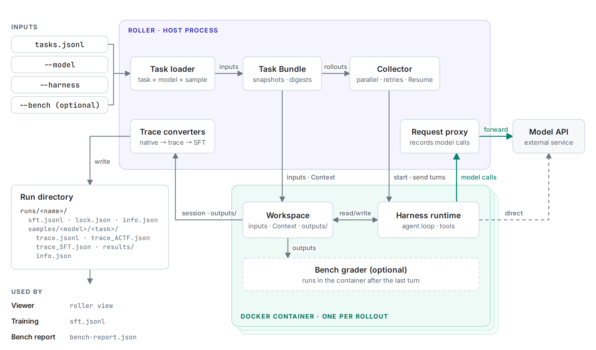
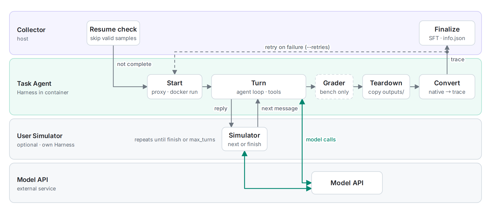

# Introduction

Roller is a command-line tool that runs tool-using AI agents in isolated environments and keeps a complete record of each execution. The inputs are tasks, model access, and a Harness. Roller runs each task and model combination in a disposable Docker container, then copies the trace and any requested files back to the host.

This record makes repeated agent runs easier to compare, inspect, and reuse. A team can use the same task set to evaluate several models, review tool calls, build training data, or reproduce a failed run.

## 1. The problem Roller solves

An agent run contains more than its final answer. It may also depend on:

- the prompt, input files, and workspace instructions.
- the model and API protocol.
- the tools exposed by the agent runtime.
- reasoning returned by the model.
- tool calls, tool results, and files written during the task.
- timeout, retry, and version settings.

Saving only the final response loses most of that context. Roller keeps the task definition, runtime settings, native events, normalized trace, and file outputs together under one run directory.

## 2. How a run works

1. **Describe the work.** Write one or more Tasks in JSON or JSONL. A Task can contain a prompt, input files, Context files, setup commands, and an output directory.
2. **Choose how the agent runs.** Select a Harness and a model. The Harness starts the agent runtime and connects it to its tools and model API.
3. **Check the plan.** A dry-run validates the tasks and shows which rollouts Roller will create.
4. **Run in isolation.** Every Task and model combination runs in its own Docker container.
5. **Inspect or reuse the result.** Open the run in the Viewer, compare traces, or collect the generated SFT records.

~~~text
Tasks + models + Harness
            │
            ▼
    isolated rollouts
            │
            ├─ native trace
            ├─ normalized trace
            ├─ SFT sample
            └─ generated files and run metadata
~~~

The following figure shows the components of a run: the host process with the Collector, the request proxy and the trace converters, and one Docker container per rollout. Green arrows mark model calls; dashed elements are optional or conditional.

Each rollout passes through the following stages. The Collector retries a failed attempt up to `--retries` times before it finalizes the sample.

## 3. Common terms in the handbook

| Term | Meaning |
| --- | --- |
| **Task** | The work given to the agent, together with its inputs, Context, setup, and expected output location. |
| **Harness** | The agent runtime integration that starts the agent, exposes tools, and communicates with the model service. |
| **Rollout** | One attempt to run one Task with one model. |
| **Run** | A named batch containing one or more rollouts. |
| **Trace** | The recorded conversation, reasoning, tool calls, and tool results from a rollout. |
| **Viewer** | Roller's built-in read-only web interface for inspecting Tasks, trace timelines, tool calls, and run information. |

Knowledge of the file formats is not required before the first run. The [Getting started](getting-started.md) guide uses OpenClaw to produce one trajectory and opens it in the Viewer.

## 4. What Roller produces

A successful rollout normally contains:

| Output | Purpose |
| --- | --- |
| <code>trace.jsonl</code> | Keeps the Harness-native events for debugging and future conversion. |
| <code>trace_ACTF.json</code> | Represents traces from different Harnesses in one analysis and visualization format. |
| <code>trace_SFT.json</code> | Stores a linear SFT record when conversion is available. |
| <code>sft_segments/</code> | Stores compacted context windows listed in the sample's <code>info.json</code>. |
| <code>results/</code> | Contains files that the Task asked the agent to create. |
| <code>info.json</code> | Records status, timing, usage, versions, and provenance. |

The run also contains a combined <code>sft.jsonl</code> for eligible linear samples. Compacted segments remain in each sample directory. [Trajectory outputs](../traces/trajectory-outputs.md) specifies the exact retention and failure rules.

## 5. Choosing a Harness

A Harness determines which agent runtime and tools perform the task. Roller currently supports OpenClaw, Codex, Claude Code, Hermes, OpenCode, DeepSeek Harness, and Pi Agent.

When learning Roller without a requirement for a specific agent runtime, start with OpenClaw. The first-run guide uses OpenClaw because it supports both OpenAI Responses and Chat Completions style services. For another runtime, follow its dedicated Harness guide.

## 6. Where to go next

- Run Roller for the first time: [Getting started](getting-started.md)
- Define custom inputs and prompts: [Task format](../tasks/task-format.md)
- Choose or configure an agent runtime: [Harness setup](../harnesses/openclaw-configuration.md)
- Understand every generated file: [Trajectory outputs](../traces/trajectory-outputs.md)
