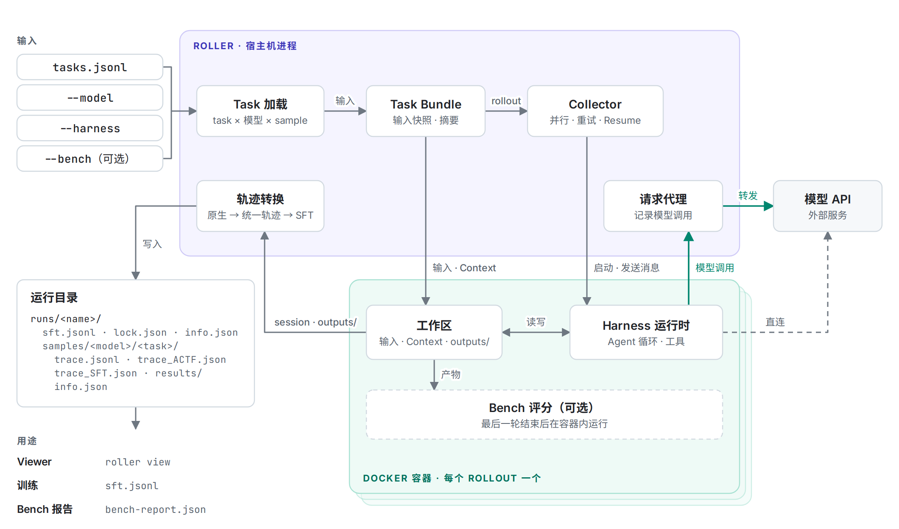
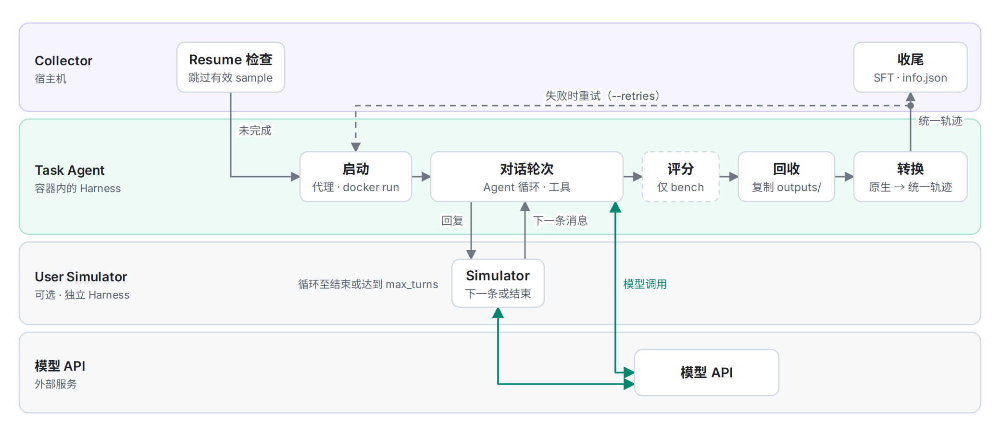

# Roller 简介

Roller 是一个命令行工具，用于在隔离环境中运行能够调用工具的 AI Agent，并完整保存运行过程。输入包括 Task、模型访问方式和 Harness。Roller 为每个 Task 与模型的组合启动一次性 Docker 容器，运行结束后将轨迹和指定文件复制回宿主机。

由此，同一批 Agent 任务可以反复运行、比较和检查。Roller 可用于对比多个模型、查看工具调用、制作训练数据或复现失败的运行。

## 1. Roller 解决什么问题

一次 Agent 运行的内容不限于最终回答，它通常还取决于：

- prompt、输入文件和工作区说明。
- 模型及其 API 协议。
- Agent 运行时提供的工具。
- 模型返回的 reasoning。
- 工具调用、工具结果以及任务过程中写出的文件。
- timeout、retry 和版本配置。

仅保存最终回答将丢失大部分上下文。Roller 将 Task 定义、运行配置、原生事件、统一轨迹和文件产物保存在同一个 run 目录中。

## 2. 一次运行如何完成

1. **描述任务。** 使用 JSON 或 JSONL 编写一个或多个 Task。Task 可包含 prompt、输入文件、Context、setup 命令和输出目录。
2. **选择运行方式。** 选择 Harness 和模型。Harness 负责启动 Agent 运行时，并连接工具和模型 API。
3. **检查执行计划。** Dry-run 校验 Task，并显示 Roller 将创建的 rollout。
4. **隔离运行。** 每个 Task 与模型的组合都在独立的 Docker 容器中执行。
5. **检查或复用结果。** 在 Viewer 中查看 run、比较轨迹，或汇总生成的 SFT 记录。

~~~text
Task + 模型 + Harness
          │
          ▼
      隔离的 rollout
          │
          ├─ 原生轨迹
          ├─ 统一轨迹
          ├─ SFT 样本
          └─ 生成文件与运行信息
~~~

下图展示一次运行涉及的组件：宿主机进程中的 Collector、请求代理和轨迹转换器，以及每个 rollout 对应的 Docker 容器。绿色箭头表示模型调用；虚线表示可选组件和条件路径。

每个 rollout 依次经历以下阶段。尝试失败时，Collector 最多重试 `--retries` 次，然后完成 sample 收尾。

## 3. Handbook 常用术语

| 术语 | 含义 |
| --- | --- |
| **Task** | 交给 Agent 的工作，以及相关的输入、Context、setup 和预期输出位置。 |
| **Harness** | 启动 Agent、提供工具并连接模型服务的运行时集成。 |
| **Rollout** | 使用一个模型执行一个 Task 的一次尝试。 |
| **Run** | 包含一个或多个 rollout 的命名批次。 |
| **Trace** | 一次 rollout 中记录的对话、reasoning、工具调用和工具结果。 |
| **Viewer** | Roller 内置的只读网页界面，用于查看一个 run 中的 Task、轨迹时间线、工具调用和运行信息。 |

首次运行前无需掌握所有文件格式。[快速上手](getting-started.md)使用 OpenClaw 生成一条轨迹，并在 Viewer 中打开该轨迹。

## 4. Roller 会保存什么

一次成功的 rollout 通常包含：

| 产物 | 用途 |
| --- | --- |
| <code>trace.jsonl</code> | 保存 Harness 原生事件，便于排错和后续重新转换。 |
| <code>trace_ACTF.json</code> | 将不同 Harness 的轨迹整理为统一的分析与可视化格式。 |
| <code>trace_SFT.json</code> | 可转换时保存一条线性 SFT 记录。 |
| <code>sft_segments/</code> | 保存压缩后的上下文分段，路径列在 sample 的 <code>info.json</code> 中。 |
| <code>results/</code> | 保存 Task 要求 Agent 生成的文件。 |
| <code>info.json</code> | 记录状态、耗时、usage、版本和运行来源。 |

run 目录仅将符合条件的线性 sample 汇总到 <code>sft.jsonl</code>；压缩分段保存在各 sample 目录中。准确的保留规则和失败行为见[轨迹产出文件](../traces/trajectory-outputs.md)。

## 5. 如何选择 Harness

Harness 决定使用哪一种 Agent 运行时和工具来完成任务。Roller 目前支持 OpenClaw、Codex、Claude Code、Hermes、OpenCode、DeepSeek Harness 和 Pi Agent。

若初次了解 Roller，且无需使用特定的 Agent 运行时，可先选择 OpenClaw。快速上手使用 OpenClaw，因为它同时支持 OpenAI Responses 和 Chat Completions 风格的服务。如需其他运行时，请参阅对应的 Harness 指南。

## 6. 后续阅读

- 首次运行 Roller：[快速上手](getting-started.md)
- 编写自定义输入和 prompt：[Task 格式](../tasks/task-format.md)
- 选择或配置 Agent 运行时：[Harness 配置](../harnesses/openclaw-configuration.md)
- 了解各类产出文件：[轨迹产出文件](../traces/trajectory-outputs.md)
